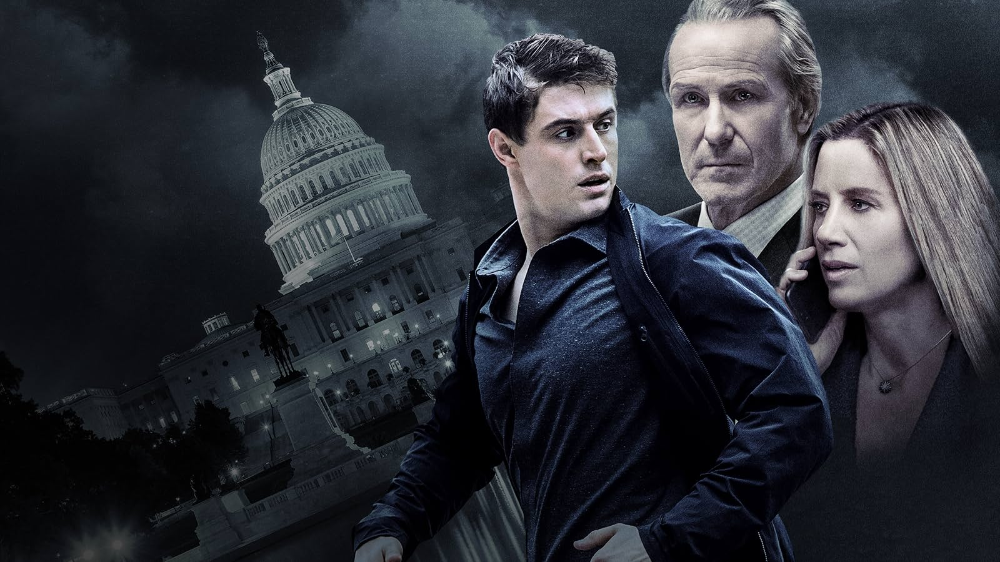
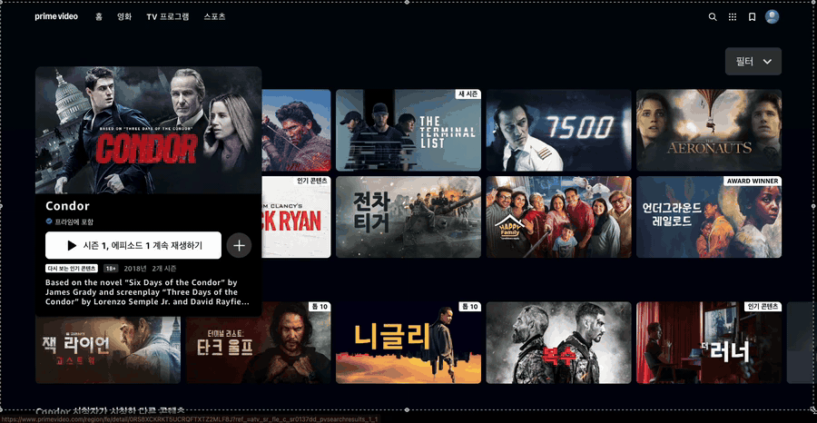

# 콘도르 (Condor) — 한국어 자막

미국 CIA 스릴러 드라마 **Condor** (2018, 시즌 2까지) 비공식 한국어 자막.
**국내 아마존 프라임 비디오(한국 프라임 비디오)** 에서 볼 수 있는데 한국어 자막이 없어서 직접 번역한 팬 자막. 프라임 비디오 재생 화면 위에 한국어 자막을 띄우는 크롬 확장 포함.

- 현재 공개 범위: **시즌 1 — 1화 「어떤 외로움」(What Loneliness), 2화 「모든 문제의 해결책」(The Solution to All Problems)**
- 다음 화는 검수 끝나는 대로 순서대로 공개

## 만든 이유

한국 프라임 비디오에 떡하니 올려 두고 **한국어 자막은 없음**. 영어 자막 하나 달랑… 
한국 서비스에 올렸으면 한국어 자막 정도는 달아 줘야 하는 거 아님? 아마존은 반성 좀 하자. 😤

- 이 쫄깃한 첩보 스릴러를 언어 장벽 때문에 놓치기엔 아까워서 직접 번역함

## 처음이라면: 따라 하기

크롬 브라우저 기준, 약 5분.

### ① 자막 파일 받기
- 이 페이지 위쪽 초록색 **`<> Code`** 버튼 → **Download ZIP**
- 받은 ZIP 파일을 더블클릭해서 압축 풀기

### ② 크롬에 자막 확장 설치하기
- 크롬 주소창에 `chrome://extensions` 입력 후 Enter
- 오른쪽 위 **개발자 모드** 스위치 켜기
- 왼쪽 위 **압축해제된 확장 프로그램 로드** → 압축 푼 폴더 안의 **`extension`** 폴더 선택
- 주소창 오른쪽 퍼즐 조각(🧩) → 📌 눌러서 고정해 두면 편함

### ③ 한국 프라임 비디오에서 드라마 틀기
- [프라임 비디오](https://www.primevideo.com)에서 **Condor** 검색 → 시즌 1, 1화 재생
- 국내 아마존 프라임 비디오 계정 그대로 시청 가능 (VPN 필요 없음)

### ④ 한글 자막 켜기
- 영상이 나오면 고정해 둔 확장 아이콘 클릭 (또는 `Option+Shift+S`, 윈도우는 `Alt+Shift+S`)
- 왼쪽 위 패널에서 **회차** 고르기
- 프라임 비디오 자체 영어 자막은 꺼 두는 걸 추천 (확장이 영어 원문도 같이 보여 줌)

## 사용법

### 영어 + 한글 함께 보기
- 기본 표시: 한글 자막 아래에 영어 원문이 작게 함께 표시
- 패널 메뉴 또는 `K` 키로 **영어+한글 / 한글만** 전환
- 자막이 화면 요소와 겹치면 패널의 **▲ 위로 / ▼ 아래로**로 높이 조절 (설정 자동 저장)

### 단축키

| 키 | 기능 |
|---|---|
| `H` | 자막 잠시 끄기 |
| `K` | 영어+한글 / 한글만 전환 |
| `P` | 조작 패널 열기/닫기 |

- 한국 프라임 비디오 영상에 맞춰 만든 자막이라 따로 싱크를 맞출 필요 없음
- 단축키가 안 먹으면 영상을 한 번 클릭한 뒤 다시 시도. 패널 버튼으로도 같은 기능 사용 가능
- 다른 확장이 `Option+Shift+S`를 이미 쓰고 있으면 단축키가 안 잡힘 → `chrome://extensions/shortcuts`에서 직접 지정

### 자막이 안 뜨거나 이상할 때: 진단 복사로 제보
1. 문제가 생긴 순간 패널의 **진단 복사** 버튼 클릭
2. 이 저장소의 [**Issues**](../../issues) → **New issue**
3. 어떤 상황이었는지 한 줄 + 복사된 진단 내용 붙여 넣기 (`⌘V` / `Ctrl+V`)

- 진단 내용에는 회차·재생 시간만 담기고 개인 정보는 없음

### 글꼴 (선택)
- 기본 글꼴: **a시네마** (극장 영화 자막 느낌)
- 설치: [아시아폰트](http://www.asiafont.com/) → 폰트통 설치 → "시네마" 검색 → a시네마 L/M/B 설치 (개인 사용 무료)
- 미설치 시 나눔고딕·맑은 고딕 등 기본 글꼴로 표시. 패널의 **글꼴** 메뉴에서 변경 가능

### 확장 없이 쓰기
- `subtitles/s1e1.ko.srt`, `subtitles/s1e2.ko.srt` — 일반 SRT 자막 파일
- SRT를 불러올 수 있는 플레이어라면 그대로 사용 가능
- 한국 프라임 비디오 영상 기준으로 맞춘 싱크라 다른 출처 영상은 조정이 필요할 수 있음

## 작품 소개

- 원작: 제임스 그레이디의 소설 『콘도르의 6일』(1974), 영화 「코드네임 콘돌」(1975)
- 배경: 현대 워싱턴 DC
- 내용: 테러 위험인물을 골라내는 알고리즘을 만든 젊은 CIA 분석관 조 터너가 어느 날 동료들이 모두 살해당한 사건에 휘말리며 쫓기는 이야기
- 원작 소설·영화를 몰라도 감상에 지장 없음
- 출연·배역: [IMDb에서 보기](https://www.imdb.com/find/?q=Condor%202018)

## 등장인물

⚠️ 스포일러 주의 — 펼쳐서 보기 (1화 기준 인물 소개)

| 인물 | 소개 |
|---|---|
| **조 터너** (Joe Turner) | 주인공. CIA 소속 분석관. 자기가 만든 알고리즘이 쓰이는 방식에 회의를 느낌 |
| **밥 패트리지** (Bob Partridge) | 조의 삼촌이자 CIA 고위 간부. 조를 CIA로 이끈 사람 |
| **샘 바버** (Sam Barber) | 조의 가장 친한 친구이자 CIA 동료 |
| **메이 바버** (Mae Barber) | 샘의 아내. 의사. 연애 안 하는 조를 늘 걱정함 |
| **캐시 H.** (Kathy H.) | 데이팅 앱으로 만난 변호사 |
| **해럴드 플로로스** (Harold Floros) | 조의 사무실 동료. 함께 알고리즘을 만든 사람 |
| **애벗** (Abbott) | CIA 부국장 |

## 번역 원칙

⚠️ 스포일러 주의 — 펼쳐서 보기 (인물 관계와 말투에 대한 내용 포함)

| 원칙 | 이유 |
|---|---|
| 한 줄 22자 안쪽 | 영어+한글을 함께 띄워도 화면을 덜 가리도록. 주고받는 대사(`-`)만 화자별 줄바꿈 |
| 조 ↔ 샘·메이: 반말 | 오래된 친구 사이 |
| 조 → 밥 삼촌: 해요체 / 밥 → 조: 반말 | 조카와 삼촌이자 직장 상하 관계 |
| 조 ↔ 애벗 부국장: 합니다체 | 처음 보는 CIA 최고위층 앞의 긴장감 |
| 조 ↔ 캐시: 해요체 | 막 만난 사이. 관계가 바뀌면 말투도 바뀜 |
| 화면 속 글자도 번역 | 제목 화면 인용문, 화면 속 메시지 등 영어 자막에 없는 글자도 한글로 표시 |
| 효과음 표시 생략 | [총소리], [한숨] 등은 화면과 소리로 충분히 전달됨. 자막은 대사에 집중 |
| 노래 가사는 번역 안 함 | 저작권 때문에 ♪만 표시 |

- 오역·어색한 표현 제보는 [이슈](../../issues)로 남기면 반영

## 알림

- 비공식 팬 번역. 개인 감상 용도로만 사용 부탁
- 영상 파일은 포함하지 않음
- 작품의 모든 권리는 원저작권자(MGM Television / Skydance 등)에게 있음
- 권리자 요청 시 즉시 내림
- 저작권 관련 문의·게시 중단 요청: **gabiji433@gmail.com**
- 국내 정식 한국어 자막이 나오면 이 자막은 내리고 정식 서비스를 안내할 예정
